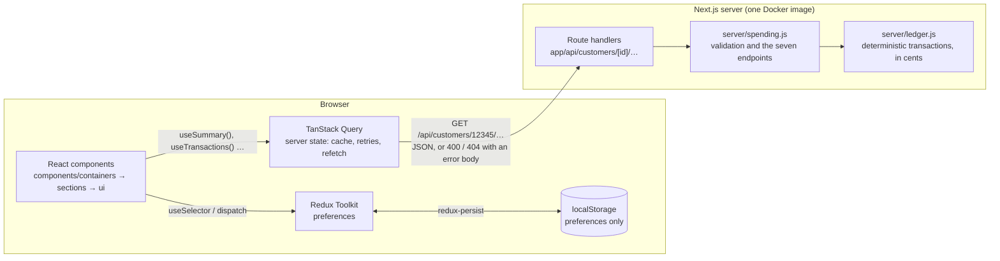
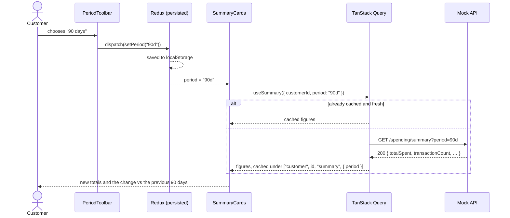
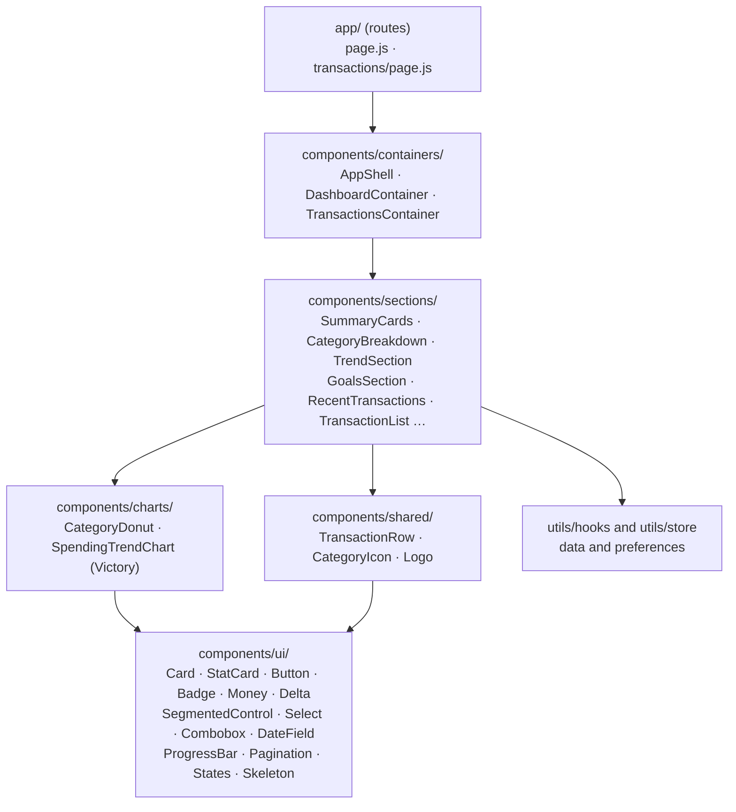

# Spending Insights

A dashboard that shows a Capitec client where their money goes, on a phone or a desktop.
It covers spending by category, the trend month by month, budgets, and every
transaction. It is my submission for the Software Engineer (Front-End) take-home,
project 1: Customer Spending Insights Dashboard.


All of the data is made up. The mock API implements the seven endpoints in
`CustomerSpendingInsightsEndpoints.md`, and every one of them reads the same set of
generated transactions. So the summary, the category split, the trend and the list agree
with each other, and a filter actually changes what comes back.

## Run it

With Docker, which is all you need:

```sh
docker build -t spending-insights .
docker run --rm -p 3000:3000 spending-insights
```

Then open <http://localhost:3000>. Lint and the unit tests run inside the build, so if the
image builds, they passed. The container runs as an unprivileged user, and its health
check calls a real API endpoint.

Or locally, with Node 20.9 or newer:

```sh
npm ci
npm run dev        # http://localhost:3000, with hot reload
```

## Test it

```sh
npm run lint       # ESLint, no warnings allowed
npm test           # unit and component tests (Vitest + Testing Library)
npm run build
npm run test:e2e   # end-to-end in a real browser, desktop and phone (Playwright)
npm run test:all   # all of the above, in order
```

`test:e2e` tests the production build, so run `npm run build` first. It needs a browser:
either run `npx playwright install chromium` once, or point it at an installed Chrome with
`PW_CHANNEL=chrome npm run test:e2e`.

On every push, GitHub Actions runs all of this, then builds the Docker image, starts it
and waits for the health check to pass (`.github/workflows/ci.yml`).

| | What is covered |
| --- | --- |
| API (29 tests) | every endpoint; validation and error codes; the endpoints agreeing with each other to the cent; percentages adding to 100; budget pace; 404s; no internal fields leaked |
| Front end (37 tests) | formatting; the preferences slice and what it persists; components (the searchable picker's keyboard and screen-reader behaviour, the period switch, hidden amounts, progress, paging); sections rendered against the real API logic, including failure and retry |
| End to end (26 runs) | the overview, period changes surviving a reload, hiding amounts, switching customer by searching, a customer with no budgets, a category row and a donut slice each opening their transactions, paging and sorting, the table view, pointer cursors, no sideways scroll, and an axe WCAG 2 AA scan of both pages, each on desktop and phone |

## What it does

| | |
| --- | --- |
| Summary | Total spent, number of transactions, the average and the top category, for 7 days, 30 days, 90 days or a year. Each is compared with the period just before it. |
| Spending by category | A donut, with the same figures listed beside it. Click a slice or a row to open that category's transactions with the filter already set. You can also pick your own date range. |
| Monthly spending | 6, 12 or 24 months as bars, with a dashed line for the average month. Switch to a table to read exact figures. The current month is drawn lighter because it hasn't finished. |
| Monthly budgets | How much of each budget is used, plus a small mark showing where spending would be if it were spread evenly over the month. "Watch this" means you're ahead of that pace, which can happen well before 80% is gone. |
| Transactions | Filter by category and dates, sort by date or amount either way, and show 10 to 100 per page. |
| Hide amounts | One switch hides every rand figure, from screen readers as well as from view. Useful when someone is looking over your shoulder. |
| Viewing as | A searchable picker for the six demo clients. Type "merwe", "67890" or "premium" and the list narrows as you type. More on it [below](#the-searchable-picker). |
| Remembered | The period, filters, sort, page size, the client you're viewing and the hide-amounts switch are kept between visits. The figures never are. |


<p align="center"></p>

## How it is built

This is a React 19 app. Every screen is function components and hooks, with Redux
Toolkit and TanStack Query for state. Next.js handles the page routing and the production
server, and it hosts the mock API.

Only five imports in four files are specific to Next: `Link` and `usePathname` in the
shell and two sections, and `Image` in the logo. Moving to Vite with React Router would
mean changing those five lines. The components, hooks and store would move as they are.
The API address is one setting, `NEXT_PUBLIC_API_BASE`. Point it at a real back end and
the route handlers in `app/api` can go.



Figures stay in TanStack Query's in-memory cache. The only thing written to the browser
is what the customer chose.

Here is what happens when the customer picks a different period:



The components are layered, and each layer only uses the ones below it:



Sections are the only layer that fetches data. Each one draws its own loading, error and
empty states, so if one endpoint fails, one card shows an error and the rest of the page
carries on.

| | |
| --- | --- |
| Framework | Next.js 16 (App Router), React 19, JavaScript |
| Server state | TanStack Query: one hook per endpoint (`utils/hooks/useSpendingApi.js`) |
| Client state | Redux Toolkit, with redux-persist saving the preferences to localStorage |
| Charts | Victory |
| Icons | react-icons (the Tabler set) |
| Styling | Tailwind CSS 4, with the Capitec palette as theme tokens (`app/globals.css`) |
| Mock API | Next route handlers under `app/api`, over pure functions in `server/` |
| Tests | Vitest, Testing Library, Playwright, axe-core |

```
app/                     routes only: the two pages and the API endpoints
components/
  ui/                    generic pieces: Card, StatCard, Button, Badge, Money, Delta,
                         SegmentedControl, Select, Combobox, DateField, ProgressBar,
                         Pagination, States, Skeleton
  charts/                CategoryDonut and SpendingTrendChart (Victory)
  shared/                TransactionRow, CategoryIcon, Logo
  sections/              the dashboard's parts; each fetches its own data
  containers/            one per page, plus the app shell; they arrange sections
utils/
  hooks/                 useSpendingApi (one hook per endpoint), useElementWidth
  store/                 the Redux store and the preferences slice
  providers/             AppProviders: Redux, redux-persist and TanStack Query
  lib/                   formatting, periods, the HTTP client and the query client
server/                  the mock API's data and logic (runs on the server only)
e2e/                     Playwright tests
```

## What `server/` is for

The brief gives the API's shape but no API, so this project brings its own. `server/`
holds it, and none of it ever reaches the browser:

- `catalogue.js` has the fixed data: the six demo clients and their budgets, the
  categories, the merchants, and the debits that recur every month.
- `ledger.js` generates each client's transactions from that data. It's deterministic,
  so the same request always gets the same answer, and it works in cents.
- `spending.js` has one function per endpoint. Each takes the client id, the query and
  "now", validates them, and returns the response body.
- `http.js` turns a function's result into an HTTP response, with the status code, the
  error body and the no-cache header.

The files in `app/api/` are thin: each one reads the request and calls one function from
`spending.js`. That split is why the API's rules have their own tests that never start a
server. If Capitec's real API were plugged in, `server/` and `app/api/` would both go and
the screens wouldn't change.

The reasoning behind all of this, and what would change before real client data went
near it, is in [docs/DECISIONS.md](docs/DECISIONS.md).

## The API

Every endpoint sits under `/api/customers/{customerId}/`. There are six demo clients.
`12345` is the one from the brief and opens by default. Two are there to show edge cases:
`11223` joined recently, so there's no earlier period to compare against, and `99887` has
no budgets.

| Endpoint | Query |
| --- | --- |
| `GET /profile` | |
| `GET /spending/summary` | `period` = `7d` `30d` `90d` `1y` |
| `GET /spending/categories` | `period`, or `startDate` and `endDate` (YYYY-MM-DD) |
| `GET /spending/trends` | `months` 1 to 24 |
| `GET /transactions` | `limit` 1 to 100, `offset`, `category`, `startDate`, `endDate`, `sortBy` |
| `GET /goals` | |
| `GET /filters` | |
| `GET /api/customers` | An addition for the demo picker only; see the Q&A |

Responses use the brief's shapes. A bad request gets a `400` and an unknown client a
`404`, and both say what was wrong:

```json
{ "error": { "code": "INVALID_LIMIT", "message": "limit must be a whole number from 1 to 100", "details": { "limit": "500" } } }
```

Two environment variables help with testing. `MOCK_NOW` fixes the API's clock (the
end-to-end tests use `2026-10-11T12:00:00Z`). `MOCK_LATENCY_MS` slows every response down,
so you can see the loading states.

## The searchable picker

"Viewing as" in the header is `components/ui/Combobox.jsx`, a reusable component. A
native `<select>` can't be searched and only shows one line per option, which is fine for
five items and tiring for fifty.

Typing narrows the list. It matches the name, the client number or the account type, in
any order, and ignores case and accents, so "zoe" finds "Zoë". Each option has two lines,
the name and then the account type and number, so two clients with similar names can be
told apart.

It works fully from the keyboard. The arrow keys open it with the search box already
focused, up and down move through the results, Home and End jump to either end, Enter
chooses and Escape closes. Either way, focus goes back to the button. It follows the
WAI-ARIA combobox pattern, so a screen reader announces each option as you move and
tells you how many results there are as you type, including when there are none.

The other dropdowns (category, sort, page size) are short fixed lists, so they're native
selects, and a phone shows its own picker for them. Their arrow is an icon with some room
around it rather than the browser's default, which sits against the edge.

## Questions a reviewer might ask

**Why Next.js, when the role asks for React?**
Because it is React. Every screen is function components and hooks. Next does the routing,
runs the server and hosts the mock API, and only five imports depend on it. See
[How it is built](#how-it-is-built).

**Why is there no sign-in?**
The brief doesn't ask for one, and a pretend login with pretend passwords wouldn't prove
much. The "Viewing as" picker stands in for it. In production the client is whoever is
signed in, and the server works that out from the session. The client id would never come
from the URL or a list, otherwise anyone could read someone else's account by changing a
number.

**Why can't I add or edit a transaction?**
All seven endpoints in the brief are read-only, and the brief asks to display spending.
Customers don't create transactions in a bank; card payments, debit orders and transfers
do. Adding them would mean inventing endpoints the spec doesn't have.

**Why build the API instead of returning the sample JSON?**
The samples can't be filtered, and they disagree with each other: their category shares
add up to 99.9%. With generated data every filter does something real, and the tests can
check that the summary, the categories and the transactions agree to the cent.

**Why both TanStack Query and Redux?**
They hold different things. TanStack Query holds whatever came from the server, and
handles caching, retries, refetching and loading. Redux holds what the customer chose,
and that's the only thing saved to the browser. Keeping figures out of browser storage is
on purpose. A stale balance is worse than a loading skeleton, and account data has no
business sitting in localStorage.

**Why are amounts in cents?**
Floating-point rands drift (`0.1 + 0.2 !== 0.3`). Everything is added up in whole cents,
and only turned into rands when the response is written.

**Why Victory for the charts?**
Its charts are React components, built up the same way as the rest of the UI. It draws
SVG and was easy to theme in Capitec's colours. The charts are hidden from screen readers
because the same figures are always on screen as text, in the list beside the donut and
the trend's table view.

**How is it tested?**
In three layers. Plain unit tests cover the API's rules. Testing Library renders the
components and sections against the real API logic. Playwright drives a real browser at
desktop and phone sizes and runs axe accessibility scans. The Docker image won't build if
lint or the unit tests fail, and CI runs the lot on every push.

**How does it behave on a slow or failing network?**
Each section has its own loading skeleton, error message and "Try again" button, so one
failing endpoint leaves the rest of the page working. A failed request is retried twice.
A `4xx` isn't retried, because asking again won't change the answer and only delays the
message. Set `MOCK_LATENCY_MS=1500` to watch the loading states.

**Is it accessible?**
It's built to WCAG 2 AA, and the end-to-end tests scan both pages with axe. Every control
works from the keyboard. Status is always written in words as well as shown in colour. The
brief's category colours are pastels, so they're used as tints behind dark icons rather
than as text. And "Hide amounts" hides figures from screen readers too.

**What would you do with more time?**
Sign-in first, with the client taken from the session on the server. Then a content
security policy based on nonces, so scripts no longer need `'unsafe-inline'`. I'd prefetch
the first view's data on the server so the page arrives filled in, give each section its
own error boundary, and add error monitoring. There's more detail in
[docs/DECISIONS.md](docs/DECISIONS.md).

---

The Capitec name and logo belong to Capitec Bank. They are used here only because this
is Capitec's own assessment.
