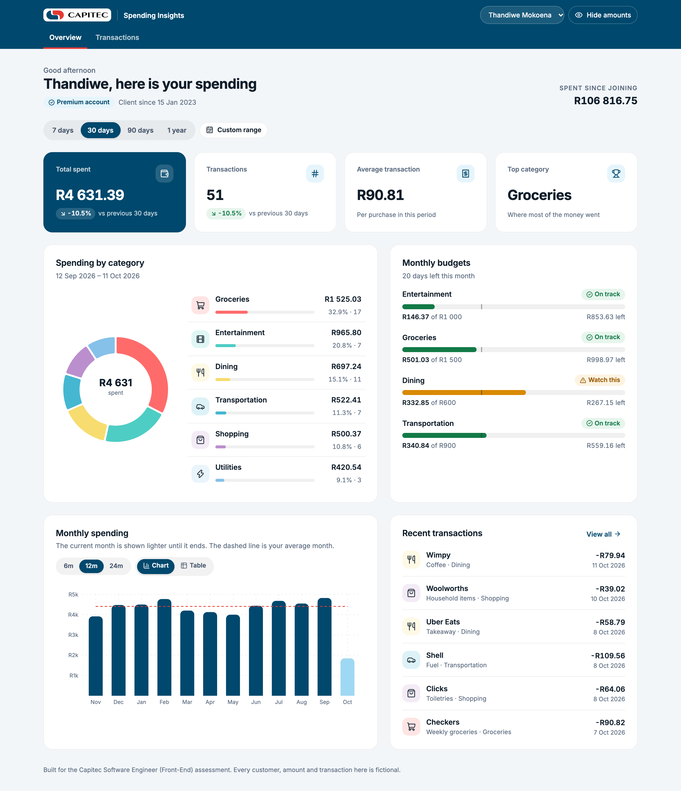
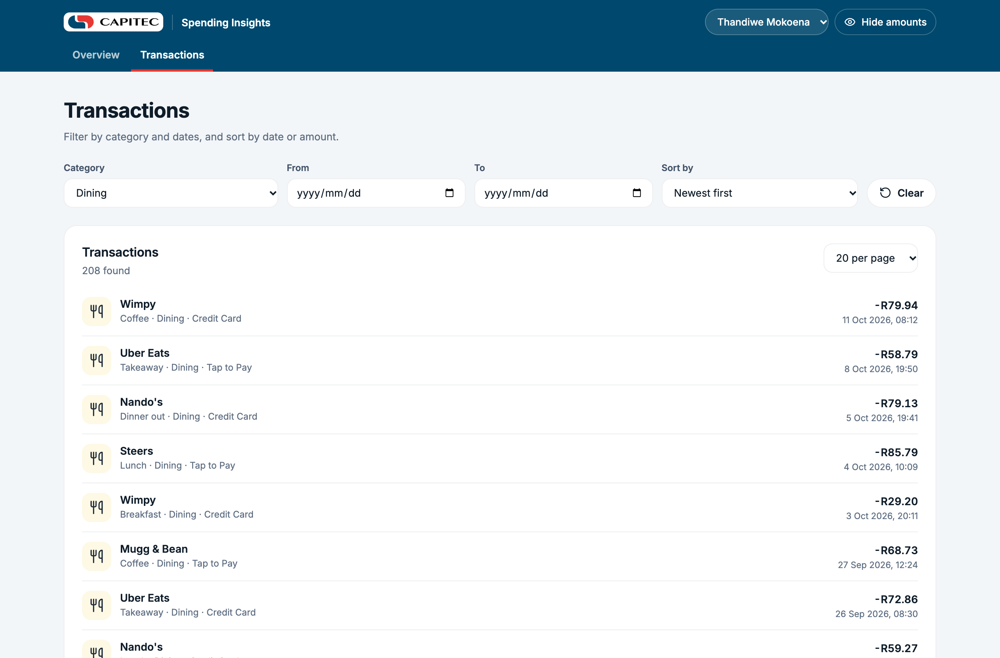
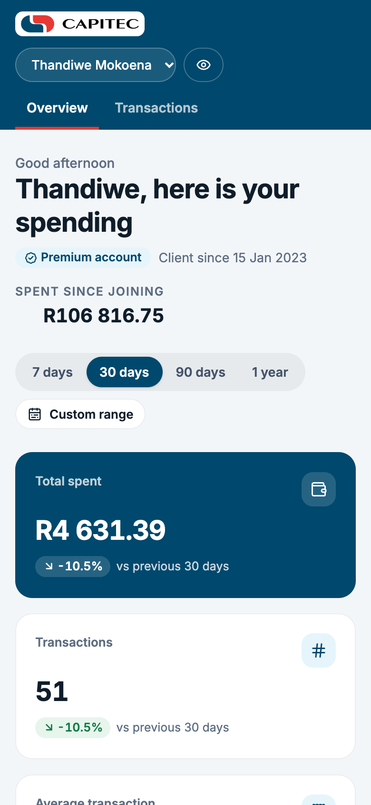
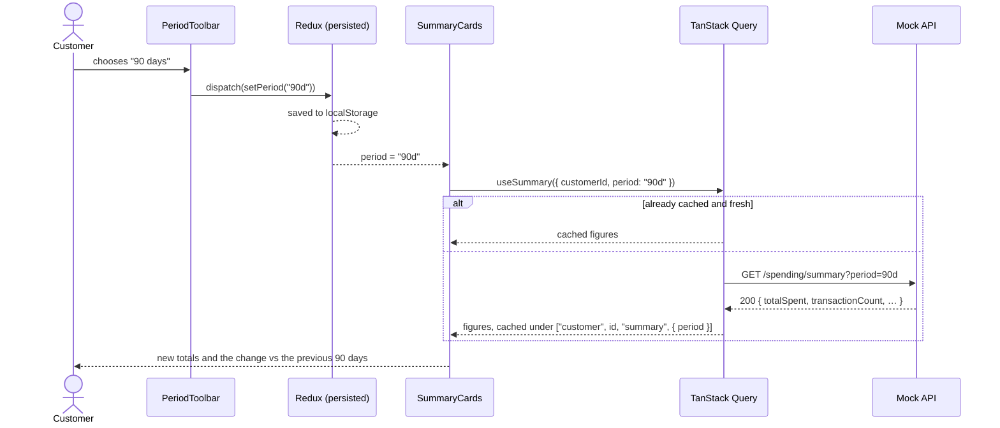
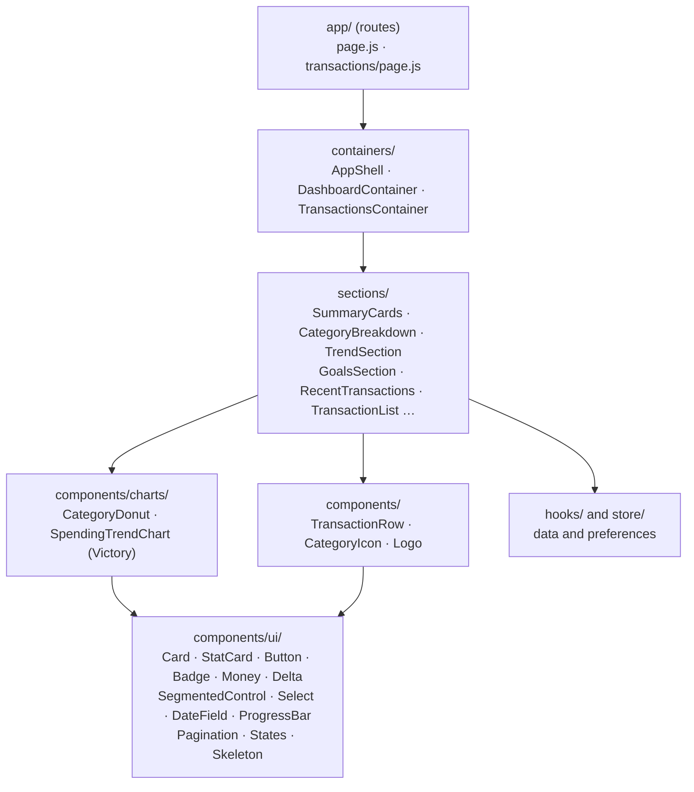

# Spending Insights

A responsive dashboard that shows a Capitec client where their money goes: spending by
category, monthly trends, budgets and every transaction. Built for the Capitec
**Software Engineer (Front-End)** take-home, *Customer Spending Insights Dashboard*.



All data is fictional. The mock API implements all seven endpoints in
`CustomerSpendingInsightsEndpoints.md`, on one consistent set of generated transactions,
so the summary, categories, trends and transaction list always agree and every filter
really filters.

## Run it

**Docker**, the only requirement:

```sh
docker build -t spending-insights .
docker run --rm -p 3000:3000 spending-insights
```

Open <http://localhost:3000>. The image runs lint and the unit tests while it builds, so
an image that builds has passed them. It runs as an unprivileged user and has a health
check against a real API endpoint.

**Locally**, with Node 20.9 or newer:

```sh
npm ci
npm run dev        # http://localhost:3000, with hot reload
```

## Test it

```sh
npm run lint       # ESLint, no warnings allowed
npm test           # unit and component tests (Vitest + Testing Library)
npm run build
npm run test:e2e   # end-to-end in a real browser, desktop and phone (Playwright)
npm run test:all   # all of the above, in order
```

`test:e2e` builds nothing itself: run `npm run build` first. It downloads nothing either:
run `npx playwright install chromium` once, or use an installed Chrome with
`PW_CHANNEL=chrome npm run test:e2e`.

GitHub Actions runs all of it on every push, then builds the Docker image, starts it and
waits for it to report healthy (`.github/workflows/ci.yml`).

| | What is covered |
| --- | --- |
| API (28 tests) | every endpoint; validation and error codes; the endpoints agreeing with each other to the cent; percentages adding to 100; budget pace; 404s; no internal fields leaked |
| Front end (29 tests) | formatting; the preferences slice and what it persists; components (keyboard use of the period switch, hidden amounts, progress, paging); sections rendered against the real API logic, including failure and retry |
| End to end (18 runs) | the overview, period changes surviving a reload, hiding amounts, a category opening its transactions, paging and sorting, the table view, no sideways scroll, and an axe WCAG 2 AA scan of both pages, each on desktop and phone |

## What it does

- **Summary**: total spent, number of transactions, average and top category for 7 days,
  30 days, 90 days or a year, each compared with the period before it.
- **Spending by category**: a donut and, beside it, the same figures as a list. Choose a
  category to open its transactions, already filtered. A custom date range is supported.
- **Monthly spending**: 6, 12 or 24 months as a bar chart with the average month marked,
  or as a table. The current month is drawn lighter because it is not over yet.
- **Monthly budgets**: each budget's use, with a marker for where spending would be if
  spread evenly through the month. "Watch this" means ahead of pace, not just "over 80%".
- **Transactions**: filter by category and dates, sort four ways, 10 to 100 per page.
- **Hide amounts**: one switch replaces every rand figure on screen and for screen readers,
  for when someone is looking over your shoulder.
- **Remembered**: the period, filters, sort, page size and the hide-amounts switch are kept
  between visits. Figures never are.



<p align="center"></p>

## How it is built

**This is a React 19 app.** Every screen is plain React: function components, hooks,
Redux Toolkit and TanStack Query. Next.js provides three things only:

- page routing;
- the production server;
- a home for the mock API.

Next-specific code is kept to five imports in four files: `Link` and `usePathname` in
the shell and two sections, and `Image` in the logo. Moving to Vite with React Router
means changing those imports; the components, sections, hooks and store move unchanged. The API sits behind one
setting, `NEXT_PUBLIC_API_BASE`: point it at a real back end and the route handlers in
`app/api` can be deleted.


Figures live only in TanStack Query's in-memory cache, and only the customer's choices
are written to the browser.

A change of period, step by step:



How the components are layered (each layer only uses the ones below it):



Sections are the only layer that fetches. Each one handles its own loading, error and
empty states, so a failing endpoint breaks one card, not the page.

| | |
| --- | --- |
| Framework | Next.js 16 (App Router), React 19, JavaScript |
| Server state | TanStack Query: one hook per endpoint (`hooks/useSpendingApi.js`) |
| Client state | Redux Toolkit, with redux-persist saving the preferences to localStorage |
| Charts | Victory |
| Icons | react-icons (the Tabler set) |
| Styling | Tailwind CSS 4, with the Capitec palette as theme tokens (`app/globals.css`) |
| Mock API | Next route handlers under `app/api`, over pure functions in `server/` |
| Tests | Vitest, Testing Library, Playwright, axe-core |

```
app/            routes: the two pages and the seven API endpoints
containers/     one per page, plus the app shell; they arrange sections
sections/       the dashboard's parts (summary, categories, trend, budgets, lists)
components/     reusable pieces: ui/ (Card, StatCard, Button, Badge, Money, Delta,
                SegmentedControl, Select, DateField, ProgressBar, Pagination, States),
                charts/, and a few shared rows and icons
hooks/          the API hooks and useElementWidth
store/          the Redux store and the preferences slice
lib/            formatting, periods, the HTTP client and the query client
server/         the mock data and the endpoint logic, with their tests
e2e/            Playwright tests
```

The choices behind this, and what would change in production, are in
[docs/DECISIONS.md](docs/DECISIONS.md).

## The API

`/api/customers/{customerId}/…`. Two customers exist: `12345` (as in the brief) and
`67890`.

| Endpoint | Query |
| --- | --- |
| `GET /profile` | |
| `GET /spending/summary` | `period` = `7d` `30d` `90d` `1y` |
| `GET /spending/categories` | `period`, or `startDate` and `endDate` (YYYY-MM-DD) |
| `GET /spending/trends` | `months` 1 to 24 |
| `GET /transactions` | `limit` 1 to 100, `offset`, `category`, `startDate`, `endDate`, `sortBy` |
| `GET /goals` | |
| `GET /filters` | |

Responses follow the brief's shapes. An invalid request is a `400` and an unknown
customer a `404`, both with a body that says what was wrong:

```json
{ "error": { "code": "INVALID_LIMIT", "message": "limit must be a whole number from 1 to 100", "details": { "limit": "500" } } }
```

Two environment variables help testing: `MOCK_NOW` pins the API's clock (the end-to-end
tests use `2026-10-11T12:00:00Z`), and `MOCK_LATENCY_MS` adds a delay so loading states can
be seen.

---

The Capitec name and logo belong to Capitec Bank. They are used here only because this
is Capitec's own assessment.
